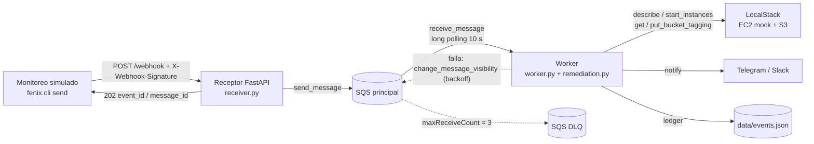

# Fénix — Sistema de autorreparación de infraestructura

TP Final 1 de **Programación para la Automatización II** (UPATECo) — Tec. Universitaria en Gestión de Infraestructura Cloud y DevOps.

> Estado: versión de entrega. Los cuatro módulos están integrados y la suite completa (63 pruebas) pasa contra LocalStack.

## Objetivo del sistema

Fénix recibe alertas de un monitoreo simulado mediante un webhook autenticado con HMAC, las valida y las guarda en SQS. Un worker independiente consume la cola, consulta el estado real del recurso afectado (EC2 mock o bucket S3 en LocalStack), lo repara y avisa el resultado por Telegram o Slack. Los mensajes se confirman solo después de reparar y avisar; los que fallan se reintentan con backoff y terminan en la DLQ si la falla persiste.

Reparaciones cubiertas:

- `instance.stopped` sobre `node-01`: la instancia vuelve a `running`.
- `bucket.tags_missing` sobre `bucket-01`: el bucket recupera las etiquetas obligatorias sin perder las ajenas.

## Integrantes y roles

| Rol | Apellido y nombre | Correo | Módulos | Pruebas defendidas |
|---|---|---|---|---|
| I3 + I5 — Webhooks, reparación, integración y worker | Fernández, Ariel | lic.arielfernandez.hys@gmail.com | `utils/crypto.py`, `services/receiver.py`, `services/remediation.py`, `services/worker.py`, `cli.py` | F02, F03, F04, F05, F06, F09, F11, F12, F13, F15 |
| I1 — Entradas y excepciones | Alves Pinto, Clelia | cleliaalves376@gmail.com | `utils/errors.py`, `utils/validation.py`, `services/events.py` | F07 |
| I2 — Mensajería e inventario cloud | Chumacero, René | renetevez273@gmail.com | `services/sqs.py`, `services/demo.py` (`setup_demo`) | F01, F08, F10 |
| I4 + I6 — Observabilidad, comunicación y diagnóstico | Díaz, Francisco | franciscodiaz799@gmail.com | `utils/logging_json.py`, `services/notifications.py`, `services/demo.py` (`inject_fault`), `tests/test_scenarios.py` | F14, F16 |

## Prerrequisitos y versiones

- Python 3.11 o superior. Versión de referencia del grupo: **Python 3.14.6** (con ella se ejecutaron la suite y el video)
- Docker Desktop iniciado
- LocalStack con la imagen indicada en `.env` (`LOCALSTACK_IMAGE`). Verificado con `localstack/localstack:3` (community 3.8.1), que no requiere token
- Git

Las versiones efectivas de las dependencias están en `requirements-lock.txt` (generado con `pip freeze` en un entorno limpio; la suite completa pasa con esas versiones exactas).

## Instalación desde cero

```bash
git clone https://github.com/prog-automatizacion-2-2026/Fenix.git
cd Fenix
python -m venv .venv
# Linux/macOS/WSL: source .venv/bin/activate
# Windows PowerShell: .venv\Scripts\Activate.ps1
python -m pip install -r requirements-lock.txt   # versiones verificadas
python -m pip install -e .
cp .env.example .env            # PowerShell: Copy-Item .env.example .env
python -c "import secrets; print(secrets.token_urlsafe(32))"   # pegar en WEBHOOK_SECRET
docker compose up -d
python -m pytest -q                  # 63 passed con LocalStack en ejecución
```

## Variables de entorno

| Variable | Uso |
|---|---|
| `AWS_ENDPOINT_URL` | Endpoint de LocalStack (`http://127.0.0.1:4566`) |
| `AWS_ACCESS_KEY_ID` / `AWS_SECRET_ACCESS_KEY` | Credenciales ficticias del emulador (`test`) |
| `AWS_DEFAULT_REGION` | Región del emulador |
| `GROUP_ID` | Identificador del grupo, usado en tags y nombres |
| `QUEUE_PREFIX` | Prefijo de la cola principal y la DLQ |
| `PROJECT` | Tag `Project` de los recursos |
| `WEBHOOK_SECRET` | Clave HMAC del receptor |
| `NOTIFY_PROVIDER` | `console`, `telegram` o `slack` |
| `TELEGRAM_BOT_TOKEN` / `TELEGRAM_CHAT_ID` | Solo si se usa Telegram |
| `SLACK_WEBHOOK_URL` | Solo si se usa Slack |
| `LOCALSTACK_AUTH_TOKEN` / `LOCALSTACK_IMAGE` | Imagen y token de LocalStack |

Ningún valor privado se sube al repositorio: `.env` está en `.gitignore`.

## Arquitectura



## Contratos de entrada y salida

Evento (contrato cerrado, todos los campos obligatorios):

```json
{
  "schema_version": 1,
  "event_id": "evt-node-001",
  "event_type": "instance.stopped",
  "resource_id": "node-01",
  "occurred_at": "2026-10-22T18:00:00Z",
  "simulate_failures": 0
}
```

| Situación HTTP | Respuesta | Efecto |
|---|---|---|
| Firma ausente, malformada, incorrecta o fuera de ventana | 401 | No se publica |
| Cuerpo mayor a 16 KiB | 413 | No se publica |
| JSON roto o UTF-8 inválido con firma válida | 400 | No se publica |
| JSON válido pero contrato incorrecto | 422 | No se publica |
| SQS no disponible después de validar | 503 | No se promete aceptación |
| SQS confirmó `send_message` | 202 con `event_id` / `message_id` | El worker procesa después |

## Ejecución por terminal

```bash
python -m fenix.cli init-queues
python -m fenix.cli setup-demo
python -m fenix.cli fault node-01

# Terminal 1 — receptor
python -m uvicorn fenix.services.receiver:app --host 127.0.0.1 --port 8000 --workers 1 --env-file .env
# Terminal 2 — worker
python -m fenix.cli worker
# Terminal 3 — alerta
python -m fenix.cli send examples/node-event.json

# Casos de rechazo (F04 / F06)
python -m fenix.cli send --firma alterada examples/node-event.json   # 401
python -m fenix.cli send --firma vencida examples/node-event.json    # 401 (timestamp de hace 1 h)
python -m fenix.cli send --firma ausente examples/node-event.json    # 401
python -m fenix.cli send --sin-validar examples/roto.json            # 400 (JSON roto firmado)

# Reintentos y DLQ (F09 / F10): cada archivo tiene su propio event_id
python -m fenix.cli send examples/node-event-reintentos.json         # falla 2 veces, se repara al 3.er intento
python -m fenix.cli send examples/node-event-persistente.json        # falla 5 veces: SQS lo deriva a la DLQ

# Estado real consultado con Boto3
python -c "import json; from fenix.config.settings import client; i=json.load(open('data/inventory.json')); print(client('ec2').describe_instances(InstanceIds=[i['node-01']['id']])['Reservations'][0]['Instances'][0]['State']['Name'])"
```

Para repetir una demostración desde cero hay que borrar `data/events.json`: si un `event_id` ya figura como completo, el worker lo confirma como duplicado sin reparar (F11).

Se usa `127.0.0.1` y no `localhost` en `AWS_ENDPOINT_URL`: en Windows, con `localhost` cada conexión intenta primero IPv6 y espera unos 2 segundos antes de caer a IPv4 (medido: 4 s por alerta contra 25 ms).

## Reglas de reintento y DLQ

- Cola principal `{QUEUE_PREFIX}-events` con `VisibilityTimeout=45` y `RedrivePolicy` hacia `{QUEUE_PREFIX}-dlq` con `maxReceiveCount=3`.
- El worker recibe de a un mensaje con long polling de 10 s. Si el handler falla (JSON roto, contrato inválido, falla simulada, error de AWS o del proveedor de avisos) **no** hace ACK: cambia la visibilidad del mismo mensaje a `min(30, 2 ** ApproximateReceiveCount)` segundos (2, 4, 8…).
- Nunca se reenvía el mensaje con `send_message`: eso reiniciaría el contador de recepciones y la DLQ no actuaría.
- Cuando SQS supera las 3 recepciones, mueve el mensaje a la DLQ por su cuenta.
- `delete_message` (ACK) se llama solo después de que el handler guardó todas sus etapas, y con el `ReceiptHandle` de la recepción actual (no con el `MessageId`).

## Decisiones de idempotencia

- `data/events.json` guarda por `event_id`: huella SHA-256 del contenido, `attempts`, `repair_done`, `repair_result`, `notified` y `status`. Cada etapa se persiste antes de pasar a la siguiente.
- Si el mismo `event_id` llega con otro contenido, se registra conflicto, el mensaje no se confirma (termina en la DLQ) y el primer registro no se modifica.
- Un evento ya completo que se repite se confirma sin reparar ni avisar de nuevo.
- Si el proceso cae después de reparar y antes de avisar, el próximo intento solo avisa: no vuelve a arrancar el nodo ni a escribir etiquetas.
- La reparación es convergente: se consulta el estado real primero; `start_instances` sobre una instancia ya `running` no hace nada y se usa en lugar de `reboot_instances`, que sí repetiría efectos. En S3 se lee, se mezcla y se vuelve a verificar, preservando etiquetas ajenas.
- No se promete "exactamente una vez": si el aviso hace timeout después de que el proveedor lo recibió, puede repetirse.

## Matriz de pruebas

Ejecución: 20/11/2026 (video y suite completa) y 21/11/2026 UTC (archivos de `evidencias/`), Python 3.14.6, LocalStack 3.8.1, Windows 11. Los datos de entrada son los eventos de `examples/` (sin datos personales). El detalle de cada prueba automática está en `evidencias/pytest_completo.txt` (63 passed).

| ID | Caso | Esperado | Obtenido | Evidencia | Responsable |
|---|---|---|---|---|---|
| F01 | `init-queues` y `setup-demo` dos veces | Mismas colas y recursos; sin duplicados | ✅ Mismas URLs de cola y mismos IDs de instancia, SG y bucket en la segunda ejecución | `evidencias/F01_idempotencia.txt`; `test_queues_are_idempotent`, `test_setup_demo_is_idempotent`; video 5:21 | Chumacero |
| F02 | Nodo detenido, evento firmado válido | Running verificado, ledger completo, aviso y ACK | ✅ `stopped` → `running` verificado con `describe_instances`; log `repaired` → `aviso_enviado` → `confirmado` | `evidencias/log_nominal.json`, `log_worker.jsonl` (`evt-demo-nodo-01`), `estado_final_boto3.txt`; video 13:43 | Fernández |
| F03 | Bucket sin Owner | Tags restauradas y etiquetas ajenas preservadas | ✅ `Owner` restaurada; `ManagedBy`, `Project` y `GroupId` intactas | `log_worker.jsonl` (`evt-demo-bucket-01`), `estado_final_boto3.txt`; video 13:43 | Fernández |
| F04 | Firma ausente/alterada y timestamp de hace una hora | 401 y ningún mensaje nuevo | ✅ 401 en los tres casos; ninguna línea nueva en el worker | `log_receptor.jsonl` (`firma_rechazada`); `test_bad_signature_is_401`, `test_old_timestamp_is_401`; video 13:43 | Fernández |
| F05 | Mismos datos JSON con bytes distintos tras firmar | 401 por HMAC inválida | ✅ 401; nada publicado | `test_same_json_other_bytes_is_401` | Fernández |
| F06 | JSON roto firmado; luego lista JSON firmada | 400 y 422; sin publicación | ✅ 400 (`JSON inválido`) y 422; nada publicado | `log_receptor.jsonl` (`json_invalido`); `test_broken_json_is_400_and_list_is_422`; video 13:43 | Fernández |
| F07 | Alias ajeno y claves extra | Rechazo de esquema; ningún cambio cloud | ✅ 422 para `node-99`, clave `prioridad` y tipo incompatible; ninguno llegó a la cola | `log_receptor.jsonl` (`contrato_rechazado`); `tests/test_events.py` (17 casos); video 1:52 | Alves Pinto |
| F08 | Evento directo a SQS con JSON corrupto | Worker sigue; mensaje termina en DLQ | ✅ El worker siguió procesando; el mensaje llegó a la DLQ tras 3 recepciones sin ACK | `evidencias/F08_json_corrupto_en_dlq.txt`; `test_corrupt_message_does_not_stop_worker` | Chumacero |
| F09 | `simulate_failures=2`, ID nuevo | Backoff 2 y 4; después reparación y ACK | ✅ `reintento_en_2s`, `reintento_en_4s` y reparación con ACK al tercer intento | `log_worker.jsonl` (`evt-demo-bucket-01`); `test_simulated_failures_survive_restart`, `test_retry_later_backoff`; video 13:43 | Fernández |
| F10 | Falla persistente, ID nuevo | Sin ACK; derivación automática a DLQ | ✅ Backoff 2, 4 y 8 s sin ACK; mensaje real leído en la DLQ sin borrarlo | `evidencias/F10_dlq_mensaje_real.txt`, `log_fallo.json`; `test_redrive_with_localstack`; video 5:21 | Chumacero |
| F11 | Repetir evento ya completo; luego reiniciar worker | Sin nueva reparación ni aviso confirmado | ✅ `evento_ya_completado` (`duplicate`) y ACK, sin reparar ni avisar; el ledger en disco sobrevive al reinicio | `log_worker.jsonl` (`evt-demo-nodo-01`); `test_completed_event_is_not_repeated`, `test_duplicate_is_idempotent`, `test_state_survives_restart`; video 13:43 | Fernández |
| F12 | Cortar después de `repair_done` y antes de notify | Reinicio recupera solo aviso pendiente | ✅ El reintento solo avisa; la reparación no se repite | `test_resume_only_pending_notification`, `test_notify_retry_does_not_repeat_repair` | Fernández |
| F13 | SQS detenido al recibir webhook | 503; no hay aceptación falsa | ✅ 503 `Cola no disponible` con LocalStack pausado (30,1 s por los timeouts del SDK) | `evidencias/F13_sqs_caido_503.txt`; `test_sqs_down_is_503` | Fernández |
| F14 | Mock de aviso 429/timeout y luego éxito | Reparación no se repite; aviso pendiente reintentado | ✅ 429/5xx/timeout → `RetryableError`; 403 → `PermanentError`; la reparación no se repite | `tests/test_notifications.py` (en `pytest_completo.txt`); video 10:07 | Díaz |
| F15 | Cambiar payload conservando `event_id` | Conflicto; no altera ledger ni recursos | ✅ Conflicto registrado; ledger y recursos sin cambios | `test_same_id_other_content_is_conflict` | Fernández |
| F16 | Forzar rotación, abrir `.gz` y parsear cada línea | JSON válido, UTC y contexto; ningún secreto | ✅ `.gz` legible; cada línea es JSON con timestamp `+00:00` y sin secretos | `evidencias/F16_historico_rotado.jsonl.gz`; `test_rotation_produces_readable_gzip`, `test_five_levels_and_null_fields` | Díaz |

## Limitaciones

- **Un solo worker.** El ledger es un archivo JSON local sin bloqueo entre procesos; dos workers en paralelo podrían pisarse.
- **Entrega "al menos una vez".** No hay garantía de exactamente una vez: si el aviso hace timeout después de que el proveedor lo recibió, puede llegar repetido.
- **EC2 simulado.** LocalStack usa `EC2_VM_MANAGER=mock`: los estados `stopped`/`running` son reales para la API, pero no hay una máquina virtual detrás.
- **Laboratorio sin persistencia.** `docker compose down` borra colas, instancia y bucket; hay que volver a correr `init-queues` y `setup-demo`. Si se recrea LocalStack, conviene borrar `data/inventory.json` y `data/events.json`.
- **Replay dentro de la ventana.** La firma rechaza mensajes de más de 300 s, pero un mismo mensaje reenviado dentro de esa ventana se acepta; el ledger evita que se repare dos veces.
- **Secreto compartido sin rotación.** `WEBHOOK_SECRET` es único y se cambia a mano.
- **Contadores aproximados.** `ApproximateReceiveCount` sube también al leer la DLQ para documentarla; no sirve como única evidencia.
- **503 lento.** Con SQS sin respuesta, el receptor tarda unos 30 s en contestar 503 (timeouts del SDK: lectura de 15 s con 2 intentos).
- **Alcance acotado.** Solo se reparan dos tipos de evento (`instance.stopped` y `bucket.tags_missing`) sobre los aliases del inventario.

## Evidencia del canal elegido

- Proveedor configurado en la grabación: `NOTIFY_PROVIDER=console`. El aviso se imprime en la terminal del worker, por ejemplo: `[Fénix] node-01 (instance.stopped): repaired. event_id=evt-demo-nodo-01` (video, 13:43).
- Los adaptadores de Telegram y Slack están implementados en `services/notifications.py` y probados con dobles: `ok: true` obligatorio en Telegram, 429/5xx/timeout reintentables, 4xx permanentes y la URL con token nunca se registra (`tests/test_notifications.py`).
- Envío real a Telegram con captura (token tapado): _(pendiente)_

## Limpieza del laboratorio

```bash
# Detener receptor, worker y visor de logs con Ctrl+C en cada terminal
docker compose down            # elimina el contenedor: colas, instancia, SG y bucket desaparecen (sin persistencia)
# PowerShell:
Remove-Item data\events.json, data\inventory.json -ErrorAction SilentlyContinue
Remove-Item logs\* -ErrorAction SilentlyContinue
# Linux/macOS: rm -f data/events.json data/inventory.json logs/*
```

`data/` y `logs/` están en `.gitignore`: nada de esto se sube al repositorio. `docker compose down` no borra la imagen descargada.

## Video

Video grupal con la ejecución real en pantalla: [carpeta en Google Drive](https://drive.google.com/drive/folders/1Ls1J6ED0fsXhaz5zOxwKaD-fG2W2_MWu?usp=sharing).

| Desde | Hasta | Integrante | Contenido |
|---|---|---|---|
| 0:00 | 1:51 | Fernández, Ariel | Presentación del equipo, arquitectura y flujo del sistema |
| 1:52 | 5:21 | Alves Pinto, Clelia | I1: validación del contrato; evento válido (202) y rechazos (422) |
| 5:21 | 10:07 | Chumacero, René | I2: colas idempotentes, laboratorio, backoff y mensaje real en la DLQ |
| 10:07 | 13:43 | Díaz, Francisco | I4 + I6: logs JSON, inyección de fallas y pruebas de avisos y rotación |
| 13:43 | 21:59 | Fernández, Ariel | I3 + I5: firma HMAC, reparación verificada, duplicado, reintentos y cierre con la suite completa |

## Declaración de ayuda externa e IA

- **Qué se utilizó:** Claude (Anthropic) como asistente de apoyo durante el desarrollo, la preparación de pruebas y la documentación. Además, la documentación oficial listada en la consigna (LocalStack, AWS SQS y Boto3) y el material de la cátedra. No hubo ayuda de personas ajenas al grupo.
- **Qué se modificó:** cada integrante revisó, ajustó e integró el código de su módulo y es responsable de explicarlo y modificarlo en la defensa. Las decisiones de diseño (contrato cerrado, backoff sobre la misma entrega, ledger por etapas, ACK al final) fueron discutidas y adoptadas por el grupo.
- **Cómo se verificó:** con la suite completa (63 pruebas, incluidas las de integración contra LocalStack), con la ejecución real grabada en el video, con las evidencias de `evidencias/` y con una instalación desde un clon nuevo siguiendo solo este README.

## Flujo de trabajo

- `main`: versión entregable. `develop`: integración.
- Cada integrante trabaja en `feature/<nombre>` y abre PR hacia `develop` usando la plantilla de `.github/pull_request_template.md`.
- El autor mergea su propio PR cuando los tests de su módulo pasan; los comentarios de otros integrantes se agregan después, sin bloquear.
