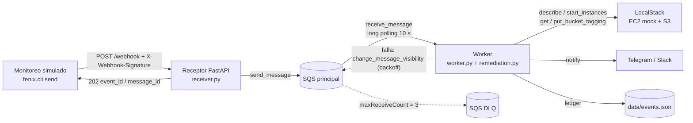

# Fénix — Sistema de autorreparación de infraestructura

TP Final 1 de **Programación para la Automatización II** (UPATECo) — Tec. Universitaria en Gestión de Infraestructura Cloud y DevOps.

> Estado: en desarrollo. Las secciones marcadas con _(pendiente)_ se completan a medida que se cierran los módulos.

## Objetivo del sistema

Fénix recibe alertas de un monitoreo simulado mediante un webhook autenticado con HMAC, las valida y las guarda en SQS. Un worker independiente consume la cola, consulta el estado real del recurso afectado (EC2 mock o bucket S3 en LocalStack), lo repara y avisa el resultado por Telegram o Slack. Los mensajes se confirman solo después de reparar y avisar; los que fallan se reintentan con backoff y terminan en la DLQ si la falla persiste.

Reparaciones cubiertas:

- `instance.stopped` sobre `node-01`: la instancia vuelve a `running`.
- `bucket.tags_missing` sobre `bucket-01`: el bucket recupera las etiquetas obligatorias sin perder las ajenas.

## Integrantes y roles

| Rol | Apellido y nombre | Correo | Módulos | Pruebas defendidas |
|---|---|---|---|---|
| I3 + I5 — Webhooks, reparación, integración y worker | Fernández, Ariel | lic.arielfernandez.hys@gmail.com | `utils/crypto.py`, `services/receiver.py`, `services/remediation.py`, `services/worker.py`, `cli.py` | F02, F03, F04, F05, F06, F09, F11, F12, F13, F15 |
| I1 — Entradas y excepciones | Alves Pinto, Clelia | cleliaalves376@gmail.com | `utils/errors.py`, `utils/validation.py`, `services/events.py` | F07 |
| I2 — Mensajería e inventario cloud | Chumacero, René | renetevez273@gmail.com | `services/sqs.py`, `services/demo.py` (`setup_demo`) | F01, F08, F10 |
| I4 + I6 — Observabilidad, comunicación y diagnóstico | Díaz, Francisco | franciscodiaz799@gmail.com | `utils/logging_json.py`, `services/notifications.py`, `services/demo.py` (`inject_fault`), `tests/test_scenarios.py` | F14, F16 |

## Prerrequisitos y versiones

- Python 3.11 o superior (misma versión para todo el grupo: _(completar)_)
- Docker Desktop iniciado
- LocalStack con la imagen indicada en `.env` (`LOCALSTACK_IMAGE`)
- Git

Las versiones efectivas de las dependencias quedan en `requirements-lock.txt` _(pendiente: generar con `pip freeze` al cerrar el Hito 4)_.

## Instalación desde cero

```bash
git clone https://github.com/prog-automatizacion-2-2026/Fenix.git
cd Fenix
python -m venv .venv
# Linux/macOS/WSL: source .venv/bin/activate
# Windows PowerShell: .venv\Scripts\Activate.ps1
python -m pip install -e .
cp .env.example .env            # PowerShell: Copy-Item .env.example .env
python -c "import secrets; print(secrets.token_urlsafe(32))"   # pegar en WEBHOOK_SECRET
docker compose up -d
```

## Variables de entorno

| Variable | Uso |
|---|---|
| `AWS_ENDPOINT_URL` | Endpoint de LocalStack (`http://localhost:4566`) |
| `AWS_ACCESS_KEY_ID` / `AWS_SECRET_ACCESS_KEY` | Credenciales ficticias del emulador (`test`) |
| `AWS_DEFAULT_REGION` | Región del emulador |
| `GROUP_ID` | Identificador del grupo, usado en tags y nombres |
| `QUEUE_PREFIX` | Prefijo de la cola principal y la DLQ |
| `PROJECT` | Tag `Project` de los recursos |
| `WEBHOOK_SECRET` | Clave HMAC del receptor |
| `NOTIFY_PROVIDER` | `console`, `telegram` o `slack` |
| `TELEGRAM_BOT_TOKEN` / `TELEGRAM_CHAT_ID` | Solo si se usa Telegram |
| `SLACK_WEBHOOK_URL` | Solo si se usa Slack |
| `LOCALSTACK_AUTH_TOKEN` / `LOCALSTACK_IMAGE` | Imagen y token de LocalStack |

Ningún valor privado se sube al repositorio: `.env` está en `.gitignore`.

## Arquitectura



## Contratos de entrada y salida

Evento (contrato cerrado, todos los campos obligatorios):

```json
{
  "schema_version": 1,
  "event_id": "evt-node-001",
  "event_type": "instance.stopped",
  "resource_id": "node-01",
  "occurred_at": "2026-10-22T18:00:00Z",
  "simulate_failures": 0
}
```

| Situación HTTP | Respuesta | Efecto |
|---|---|---|
| Firma ausente, malformada, incorrecta o fuera de ventana | 401 | No se publica |
| Cuerpo mayor a 16 KiB | 413 | No se publica |
| JSON roto o UTF-8 inválido con firma válida | 400 | No se publica |
| JSON válido pero contrato incorrecto | 422 | No se publica |
| SQS no disponible después de validar | 503 | No se promete aceptación |
| SQS confirmó `send_message` | 202 con `event_id` / `message_id` | El worker procesa después |

## Ejecución por terminal

```bash
python -m fenix.cli init-queues
python -m fenix.cli setup-demo
python -m fenix.cli fault node-01

# Terminal 1 — receptor
python -m uvicorn fenix.services.receiver:app --host 127.0.0.1 --port 8000 --workers 1 --env-file .env
# Terminal 2 — worker
python -m fenix.cli worker
# Terminal 3 — alerta
python -m fenix.cli send examples/node-event.json

# Casos de rechazo (F04 / F06)
python -m fenix.cli send --firma alterada examples/node-event.json   # 401
python -m fenix.cli send --firma vencida examples/node-event.json    # 401 (timestamp de hace 1 h)
python -m fenix.cli send --firma ausente examples/node-event.json    # 401
python -m fenix.cli send --sin-validar roto.json                     # 400 (JSON roto firmado)
```

En Windows conviene usar `AWS_ENDPOINT_URL=http://127.0.0.1:4566` (ya es el valor de `.env.example`): con `localhost` cada conexión intenta primero IPv6 y espera unos 2 segundos antes de caer a IPv4.

## Reglas de reintento y DLQ

- Cola principal `{QUEUE_PREFIX}-events` con `VisibilityTimeout=45` y `RedrivePolicy` hacia `{QUEUE_PREFIX}-dlq` con `maxReceiveCount=3`.
- El worker recibe de a un mensaje con long polling de 10 s. Si el handler falla (JSON roto, contrato inválido, falla simulada, error de AWS o del proveedor de avisos) **no** hace ACK: cambia la visibilidad del mismo mensaje a `min(30, 2 ** ApproximateReceiveCount)` segundos (2, 4, 8…).
- Nunca se reenvía el mensaje con `send_message`: eso reiniciaría el contador de recepciones y la DLQ no actuaría.
- Cuando SQS supera las 3 recepciones, mueve el mensaje a la DLQ por su cuenta.
- `delete_message` (ACK) se llama solo después de que el handler guardó todas sus etapas, y con el `ReceiptHandle` de la recepción actual (no con el `MessageId`).

## Decisiones de idempotencia

- `data/events.json` guarda por `event_id`: huella SHA-256 del contenido, `attempts`, `repair_done`, `repair_result`, `notified` y `status`. Cada etapa se persiste antes de pasar a la siguiente.
- Si el mismo `event_id` llega con otro contenido, se registra conflicto, el mensaje no se confirma (termina en la DLQ) y el primer registro no se modifica.
- Un evento ya completo que se repite se confirma sin reparar ni avisar de nuevo.
- Si el proceso cae después de reparar y antes de avisar, el próximo intento solo avisa: no vuelve a arrancar el nodo ni a escribir etiquetas.
- La reparación es convergente: se consulta el estado real primero; `start_instances` sobre una instancia ya `running` no hace nada y se usa en lugar de `reboot_instances`, que sí repetiría efectos. En S3 se lee, se mezcla y se vuelve a verificar, preservando etiquetas ajenas.
- No se promete "exactamente una vez": si el aviso hace timeout después de que el proveedor lo recibió, puede repetirse.

## Matriz de pruebas

| ID | Caso | Esperado | Obtenido | Evidencia | Responsable |
|---|---|---|---|---|---|
| F01 | `init-queues` y `setup-demo` dos veces | Mismas colas y recursos; sin duplicados | | | Chumacero |
| F02 | Nodo detenido, evento firmado válido | Running verificado, ledger completo, aviso y ACK | | | Fernández |
| F03 | Bucket sin Owner | Tags restauradas y etiquetas ajenas preservadas | | | Fernández |
| F04 | Firma ausente/alterada y timestamp de hace una hora | 401 y ningún mensaje nuevo | | | Fernández |
| F05 | Mismos datos JSON con bytes distintos tras firmar | 401 por HMAC inválida | | | Fernández |
| F06 | JSON roto firmado; luego lista JSON firmada | 400 y 422; sin publicación | | | Fernández |
| F07 | Alias ajeno y claves extra | Rechazo de esquema; ningún cambio cloud | | | Alves Pinto |
| F08 | Evento directo a SQS con JSON corrupto | Worker sigue; mensaje termina en DLQ | | | Chumacero |
| F09 | `simulate_failures=2`, ID nuevo | Backoff 2 y 4; después reparación y ACK | | | Fernández |
| F10 | Falla persistente, ID nuevo | Sin ACK; derivación automática a DLQ | | | Chumacero |
| F11 | Repetir evento ya completo; luego reiniciar worker | Sin nueva reparación ni aviso confirmado | | | Fernández |
| F12 | Cortar después de `repair_done` y antes de notify | Reinicio recupera solo aviso pendiente | | | Fernández |
| F13 | SQS detenido al recibir webhook | 503; no hay aceptación falsa | | | Fernández |
| F14 | Mock de aviso 429/timeout y luego éxito | Reparación no se repite; aviso pendiente reintentado | | | Díaz |
| F15 | Cambiar payload conservando `event_id` | Conflicto; no altera ledger ni recursos | | | Fernández |
| F16 | Forzar rotación, abrir `.gz` y parsear cada línea | JSON válido, UTC y contexto; ningún secreto | | | Díaz |

## Limitaciones

_(pendiente)_

## Evidencia del canal elegido

_(pendiente)_

## Limpieza del laboratorio

_(pendiente)_

## Video

Video grupal con la ejecución real en pantalla: [carpeta en Google Drive](https://drive.google.com/drive/folders/1Ls1J6ED0fsXhaz5zOxwKaD-fG2W2_MWu?usp=sharing).

## Declaración de ayuda externa e IA

_(pendiente)_

## Flujo de trabajo

- `main`: versión entregable. `develop`: integración.
- Cada integrante trabaja en `feature/<nombre>` y abre PR hacia `develop` usando la plantilla de `.github/pull_request_template.md`.
- El autor mergea su propio PR cuando los tests de su módulo pasan; los comentarios de otros integrantes se agregan después, sin bloquear.
